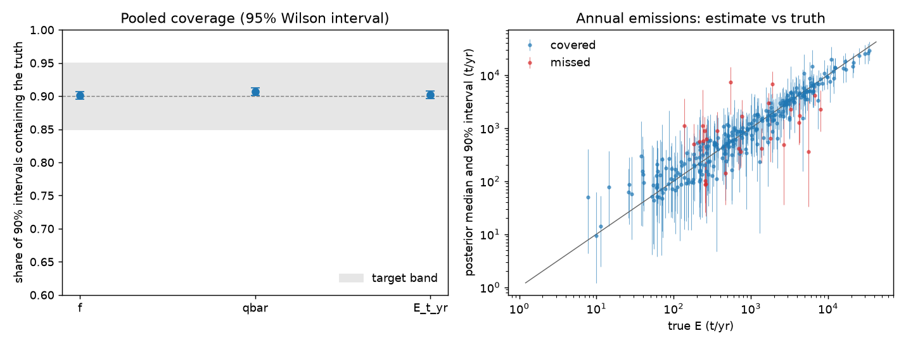

# Gate 3 at the real site count (synthetic-20261125T041949Z)

**Result: FAIL**. Target: pooled coverage of 90% intervals in [0.85, 0.95] for f, Qbar and E, and at most 10% of fits failing diagnostics.

200 replicates x 52 sites = 10400 site fits. Truths drawn from the model's priors; instrument settings from `config/synthetic.yaml` (SYNTHETIC, not measured values). Chains as long as a real fit's (`config/model.yaml`).

Site covariates: north_valley (each site in its real region; coefficients drawn from their Normal(0, 0.5) prior, ADR 0008).

| Quantity | Coverage | 95% Wilson interval |
|---|---|---|
| f | 0.901 | 0.896 to 0.907 |
| qbar | 0.907 | 0.901 to 0.912 |
| E_t_yr | 0.902 | 0.897 to 0.908 |

Fits failing diagnostics (r-hat > 1.01, bulk ESS < 400, or divergences): 18.0%.

## Coverage by detections at the site

| n_detections   |    sites |     f |   qbar |     E |
|:---------------|---------:|------:|-------:|------:|
| 0              | 3407.000 | 0.890 |  0.912 | 0.895 |
| 1-4            | 4334.000 | 0.906 |  0.906 | 0.907 |
| 5-14           | 2252.000 | 0.913 |  0.904 | 0.904 |
| 15+            |  407.000 | 0.885 |  0.887 | 0.909 |

## The shape of the simulated sites

Sites, regions and pass counts are those of a real fit: usable passes of aircraft, emit, tanager1 over the 52 registry sites, through 2026-10-08. Only the counts are used; every rate, detection and truth is simulated, and the site ids are made up.

Mean passes per site, by instrument:

| region       |   aircraft |   emit |   tanager1 |
|:-------------|-----------:|-------:|-----------:|
| bay-area     |       2.82 |   7.82 |       4.85 |
| north-valley |       2.21 |  17.11 |       1.63 |

Sites, and the fewest and most passes at one site:

| region       |   sites |   fewest |   most |
|:-------------|--------:|---------:|-------:|
| bay-area     |      33 |        4 |     35 |
| north-valley |      19 |       15 |     31 |

## Coverage by region

Each region must be inside the band as well.

| Region | Site fits | f | qbar | E_t_yr |
|---|---|---|---|---|
| bay-area | 6600 | 0.902 | 0.907 | 0.905 |
| north-valley | 3800 | 0.900 | 0.906 | 0.898 |



## Run manifest

```json
{
  "run_id": "synthetic-20261125T041949Z",
  "created_at": "2026-11-25T04:50:50.609138+00:00",
  "git_sha": "850065458b409fd9afd69460e23ccd44ee9d4091",
  "git_dirty": false,
  "config_sha256": {
    "data_terms.yaml": "64a1ad6554be7a77a247930c796d51f2ee6efb87d57ce67e97597861f87b9825",
    "impact.yaml": "04043a72046ae032c34f072d49d808d2b5c5b8961dcc20c1df23c843420def29",
    "instruments.yaml": "15eb2d691f47f724ce330c497a7be10ea45a218e1fc2ca47d90413ae86bd6bb2",
    "metrics.yaml": "84c4d626883126ada789d634606152f856253520801e42e04eaaa4aaddc9b561",
    "model.yaml": "006a6e997dcbe8dcab0a76382ba637730b4fe448b0a499e63898785d66cc7791",
    "project.yaml": "a2b059b1a83daeb37d8eeb5f1348f85e9ab07482cecd81b7efa98607ba8b7f59",
    "quantify.yaml": "b0db0f49668b7bc6d1637ae5096524d1152b0c244190e66b8478ae1d98923217",
    "sentinel2.yaml": "a56d97cb7468c5ca73336ad31e40494f540e12aaeb14c9e05212097955ed3307",
    "synthetic.yaml": "69785b159e118ff9e7b6128d161851119b966ff20b9d4becf0bf6b72a156a926"
  },
  "versions": {
    "pymc": "6.3.2",
    "pytensor": "3.3.3",
    "numpy": "2.5.3"
  },
  "n_replicates": 200,
  "gate": {
    "passed": false,
    "coverage": {
      "f": 0.9014423076923077,
      "qbar": 0.9067307692307692,
      "E_t_yr": 0.9024038461538462
    },
    "coverage_ci": {
      "f": [
        0.8955645480367415,
        0.9070236036321574
      ],
      "qbar": [
        0.9009904229484044,
        0.9121707462873901
      ],
      "E_t_yr": [
        0.8965506828838185,
        0.9079598356154251
      ]
    },
    "n_fits": 200,
    "n_site_fits": 10400,
    "diagnostic_failure_share": 0.18,
    "coverage_by_region": {
      "bay-area": {
        "f": 0.9021212121212121,
        "qbar": 0.9072727272727272,
        "E_t_yr": 0.9048484848484849
      },
      "north-valley": {
        "f": 0.9002631578947369,
        "qbar": 0.9057894736842105,
        "E_t_yr": 0.8981578947368422
      }
    },
    "n_site_fits_by_region": {
      "bay-area": 6600,
      "north-valley": 3800
    }
  },
  "covariates": [
    "north_valley"
  ],
  "layout": {
    "source": "usable passes of aircraft, emit, tanager1 over the 52 registry sites, through 2026-10-08",
    "sites_by_region": {
      "bay-area": 33,
      "north-valley": 19
    },
    "mean_passes_per_site": {
      "bay-area": {
        "aircraft": 2.82,
        "emit": 7.82,
        "tanager1": 4.85
      },
      "north-valley": {
        "aircraft": 2.21,
        "emit": 17.11,
        "tanager1": 1.63
      }
    }
  }
}
```
