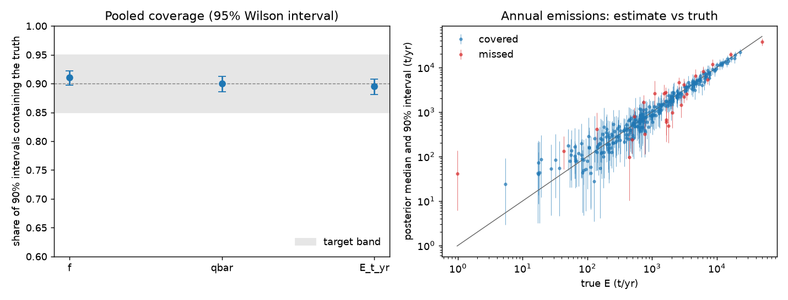

# Gate 3: synthetic recovery (synthetic-20261003T223204Z)

**Result: PASS**. Target: pooled coverage of 90% intervals in [0.85, 0.95] for f, Qbar and E, and at most 10% of fits failing diagnostics.

200 replicates x 10 sites = 2000 site fits. Truths drawn from the model's priors; instrument settings from `config/synthetic.yaml` (SYNTHETIC, not measured values).

| Quantity | Coverage | 95% Wilson interval |
|---|---|---|
| f | 0.910 | 0.897 to 0.922 |
| qbar | 0.900 | 0.886 to 0.912 |
| E_t_yr | 0.895 | 0.881 to 0.908 |

Fits failing diagnostics (r-hat > 1.01, bulk ESS < 400, or divergences): 7.0%.

## Coverage by detections at the site

| n_detections   |   sites |     f |   qbar |     E |
|:---------------|--------:|------:|-------:|------:|
| 0              | 214.000 | 0.916 |  0.949 | 0.897 |
| 1-4            | 623.000 | 0.897 |  0.892 | 0.902 |
| 5-14           | 557.000 | 0.910 |  0.885 | 0.876 |
| 15+            | 606.000 | 0.922 |  0.904 | 0.904 |



## Fixed-truth scenarios (reported, not gated)

| site_id        |   replicates |     E_true |   E_median_of_medians |   E_coverage |   f_coverage |   mean_detections |
|:---------------|-------------:|-----------:|----------------------:|-------------:|-------------:|------------------:|
| frequent-small |           20 | 788        |            694        |         0.85 |         0.8  |              7    |
| rare-large     |           20 |   1.75e+03 |              1.84e+03 |         0.95 |         0.85 |              9.05 |
| typical        |           20 |   1.31e+03 |              1.19e+03 |         0.9  |         0.85 |              9.9  |

## Run manifest

```json
{
  "run_id": "synthetic-20261003T223204Z",
  "created_at": "2026-10-03T22:50:10.985669+00:00",
  "git_sha": "c971ed44ca7e7492f6bb56504b12d4aedffc1728",
  "git_dirty": false,
  "config_sha256": {
    "impact.yaml": "daff7df8f31e870b31b97498e9d69e5f154fd7d33e7f959160d95c3cdeab6819",
    "instruments.yaml": "1a5a3da021ca9cfb6dde1deeb19a6d59f7137965cb8d931a0c04fe473f152129",
    "model.yaml": "5c326770a251a91eaefc34cdff1286105265bdc4551111caf04e4e6101f284e1",
    "project.yaml": "280b7d928f0e2bcd847e5094e41435240fc6f83e0c17ad459c59ca77c3c24d57",
    "synthetic.yaml": "69785b159e118ff9e7b6128d161851119b966ff20b9d4becf0bf6b72a156a926"
  },
  "versions": {
    "pymc": "6.3.2",
    "pytensor": "3.3.3",
    "numpy": "2.5.3"
  },
  "n_replicates": 200,
  "gate": {
    "passed": true,
    "coverage": {
      "f": 0.9105,
      "qbar": 0.9,
      "E_t_yr": 0.895
    },
    "coverage_ci": {
      "f": [
        0.8971892551645851,
        0.9222367912853938
      ],
      "qbar": [
        0.8860753173311956,
        0.9123909885883942
      ],
      "E_t_yr": [
        0.8807989826955367,
        0.9076864944000582
      ]
    },
    "n_fits": 200,
    "n_site_fits": 2000,
    "diagnostic_failure_share": 0.07
  }
}
```
