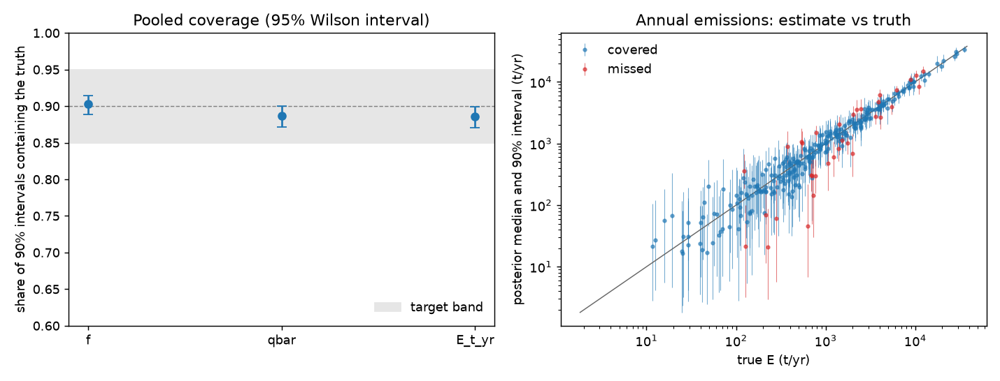

# Gate 3: synthetic recovery (synthetic-20261024T010329Z)

**Result: FAIL**. Target: pooled coverage of 90% intervals in [0.85, 0.95] for f, Qbar and E, and at most 10% of fits failing diagnostics.

200 replicates x 10 sites = 2000 site fits. Truths drawn from the model's priors; instrument settings from `config/synthetic.yaml` (SYNTHETIC, not measured values).

Site covariates: closed, log_area (made-up values; coefficients drawn from their Normal(0, 0.5) prior, ADR 0008).

| Quantity | Coverage | 95% Wilson interval |
|---|---|---|
| f | 0.902 | 0.889 to 0.915 |
| qbar | 0.886 | 0.872 to 0.900 |
| E_t_yr | 0.885 | 0.871 to 0.899 |

Fits failing diagnostics (r-hat > 1.01, bulk ESS < 400, or divergences): 11.5%.

## Coverage by detections at the site

| n_detections   |   sites |     f |   qbar |     E |
|:---------------|--------:|------:|-------:|------:|
| 0              | 281.000 | 0.911 |  0.861 | 0.875 |
| 1-4            | 582.000 | 0.888 |  0.900 | 0.873 |
| 5-14           | 567.000 | 0.922 |  0.889 | 0.905 |
| 15+            | 570.000 | 0.893 |  0.882 | 0.884 |



## Run manifest

```json
{
  "run_id": "synthetic-20261024T010329Z",
  "created_at": "2026-10-24T01:29:45.701795+00:00",
  "git_sha": "db33fa9825d7c8048dc94e6626644058eb31f767",
  "git_dirty": true,
  "config_sha256": {
    "impact.yaml": "04043a72046ae032c34f072d49d808d2b5c5b8961dcc20c1df23c843420def29",
    "instruments.yaml": "1a5a3da021ca9cfb6dde1deeb19a6d59f7137965cb8d931a0c04fe473f152129",
    "model.yaml": "8010e9eb9757c08871c9af93aa269d6a7796c92dae385f190fe764f47d8d70ff",
    "project.yaml": "9a4876dff8e9a802e0c907934d30719f720a13ffb9223174c2ed6a9f08f2c8d2",
    "quantify.yaml": "b0db0f49668b7bc6d1637ae5096524d1152b0c244190e66b8478ae1d98923217",
    "sentinel2.yaml": "a56d97cb7468c5ca73336ad31e40494f540e12aaeb14c9e05212097955ed3307",
    "synthetic.yaml": "69785b159e118ff9e7b6128d161851119b966ff20b9d4becf0bf6b72a156a926"
  },
  "versions": {
    "pymc": "6.3.2",
    "pytensor": "3.3.3",
    "numpy": "2.5.3"
  },
  "n_replicates": 200,
  "gate": {
    "passed": false,
    "coverage": {
      "f": 0.9025,
      "qbar": 0.8865,
      "E_t_yr": 0.8855
    },
    "coverage_ci": {
      "f": [
        0.8887172189824126,
        0.9147395013491744
      ],
      "qbar": [
        0.8718505801436812,
        0.8996674879511223
      ],
      "E_t_yr": [
        0.8707994946716016,
        0.8987224076584028
      ]
    },
    "n_fits": 200,
    "n_site_fits": 2000,
    "diagnostic_failure_share": 0.115
  },
  "covariates": [
    "closed",
    "log_area"
  ]
}
```
