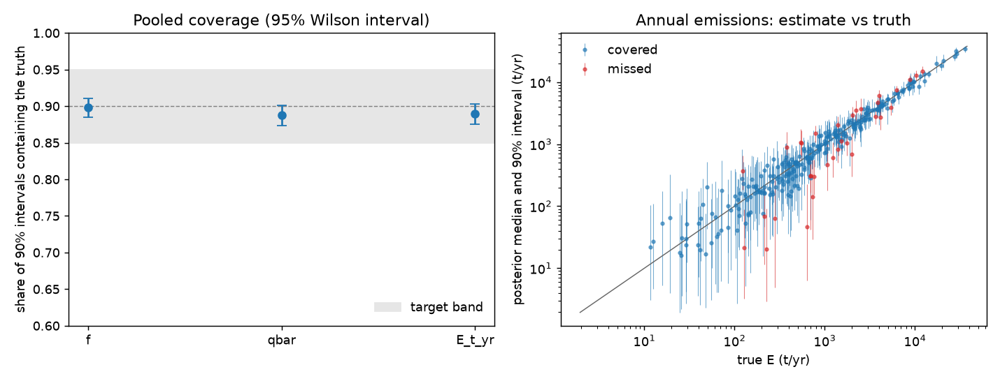

# Gate 3: synthetic recovery (synthetic-20261024T013708Z)

**Result: PASS**. Target: pooled coverage of 90% intervals in [0.85, 0.95] for f, Qbar and E, and at most 10% of fits failing diagnostics.

200 replicates x 10 sites = 2000 site fits. Truths drawn from the model's priors; instrument settings from `config/synthetic.yaml` (SYNTHETIC, not measured values).

Site covariates: closed, log_area (made-up values; coefficients drawn from their Normal(0, 0.5) prior, ADR 0008).

| Quantity | Coverage | 95% Wilson interval |
|---|---|---|
| f | 0.898 | 0.884 to 0.911 |
| qbar | 0.888 | 0.873 to 0.901 |
| E_t_yr | 0.889 | 0.875 to 0.903 |

Fits failing diagnostics (r-hat > 1.01, bulk ESS < 400, or divergences): 4.5%.

## Coverage by detections at the site

| n_detections   |   sites |     f |   qbar |     E |
|:---------------|--------:|------:|-------:|------:|
| 0              | 281.000 | 0.911 |  0.879 | 0.879 |
| 1-4            | 582.000 | 0.881 |  0.900 | 0.878 |
| 5-14           | 567.000 | 0.917 |  0.885 | 0.907 |
| 15+            | 570.000 | 0.891 |  0.882 | 0.889 |



## Run manifest

```json
{
  "run_id": "synthetic-20261024T013708Z",
  "created_at": "2026-10-24T02:03:13.869576+00:00",
  "git_sha": "db33fa9825d7c8048dc94e6626644058eb31f767",
  "git_dirty": true,
  "config_sha256": {
    "impact.yaml": "04043a72046ae032c34f072d49d808d2b5c5b8961dcc20c1df23c843420def29",
    "instruments.yaml": "1a5a3da021ca9cfb6dde1deeb19a6d59f7137965cb8d931a0c04fe473f152129",
    "model.yaml": "1f24562854d55d922e9a2e1a570708c8cdb12987d61315cda05c56e0689ac768",
    "project.yaml": "9a4876dff8e9a802e0c907934d30719f720a13ffb9223174c2ed6a9f08f2c8d2",
    "quantify.yaml": "b0db0f49668b7bc6d1637ae5096524d1152b0c244190e66b8478ae1d98923217",
    "sentinel2.yaml": "a56d97cb7468c5ca73336ad31e40494f540e12aaeb14c9e05212097955ed3307",
    "synthetic.yaml": "69785b159e118ff9e7b6128d161851119b966ff20b9d4becf0bf6b72a156a926"
  },
  "versions": {
    "pymc": "6.3.2",
    "pytensor": "3.3.3",
    "numpy": "2.5.3"
  },
  "n_replicates": 200,
  "gate": {
    "passed": true,
    "coverage": {
      "f": 0.8985,
      "qbar": 0.888,
      "E_t_yr": 0.8895
    },
    "coverage_ci": {
      "f": [
        0.8844913895736582,
        0.910980667698733
      ],
      "qbar": [
        0.8734278486967983,
        0.9010844680452037
      ],
      "E_t_yr": [
        0.8750058976192777,
        0.9025006677699227
      ]
    },
    "n_fits": 200,
    "n_site_fits": 2000,
    "diagnostic_failure_share": 0.045
  },
  "covariates": [
    "closed",
    "log_area"
  ]
}
```
